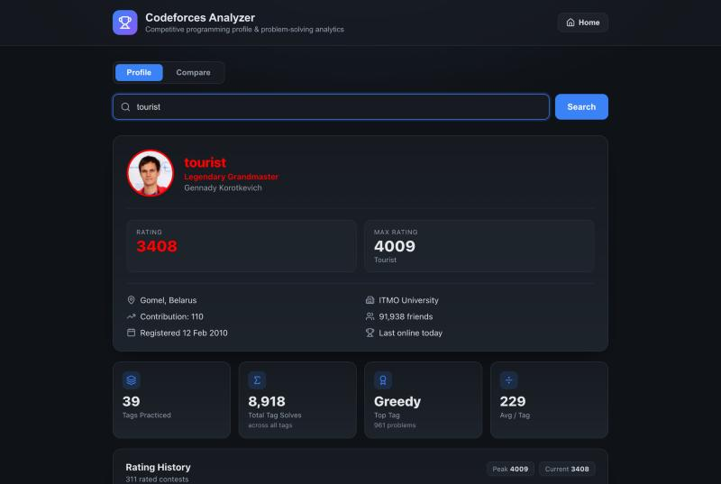
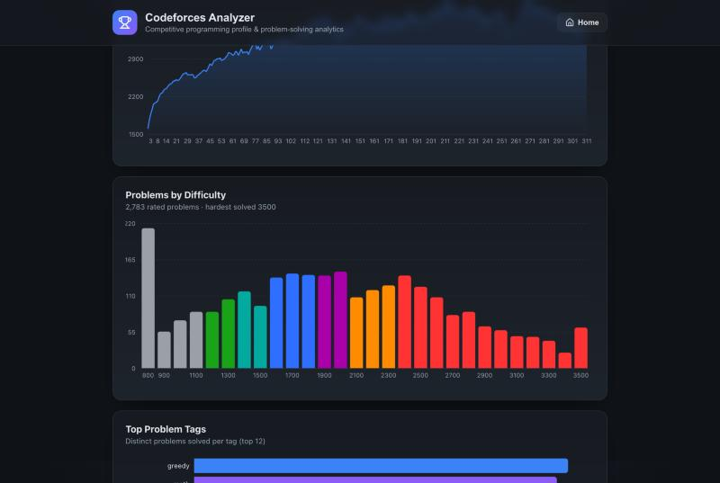
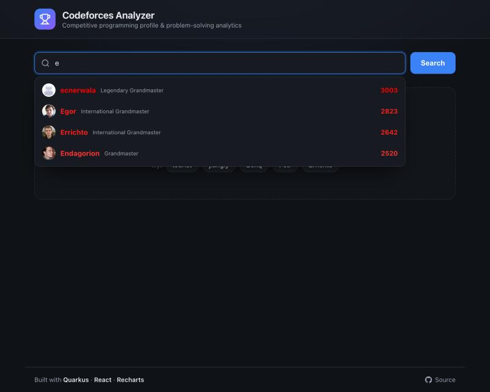
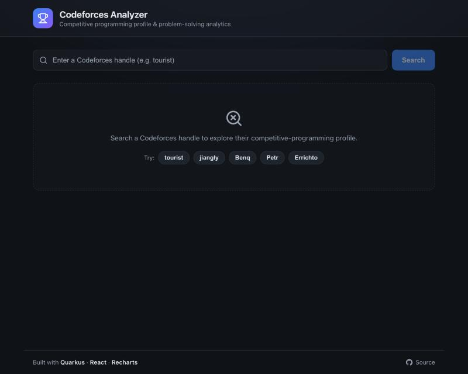

# 🏆 Codeforces Analyzer

[](https://openjdk.org/)
[](https://quarkus.io/)
[](https://react.dev/)
[](https://vitejs.dev/)
[](https://mongodb.com/)
[](https://redis.io/)
[](https://www.docker.com/)

> A **full-stack competitive-programming analytics dashboard**. Enter any Codeforces handle and instantly explore a rich profile: rating history, problems solved by difficulty and tag, summary stats, and recent blog entries — powered by a **Quarkus** backend (MongoDB + Redis) and a responsive **React + Vite** frontend.

---

## 📸 Screenshots

| Dashboard | Analytics |
|---|---|
|  |  |

| Smart search autocomplete | Landing |
|---|---|
|  |  |

---

## ✨ Features

### Frontend
- 🔎 **Smart search with autocomplete** — debounced, abortable, client-cached handle suggestions (avatar, rank color, rating)
- ⚔️ **Compare two users** — head-to-head stats with winner highlighting and an overlaid rating-over-time chart
- 👤 **Profile card** — avatar, rank-colored handle, current/max rating, organization, country, activity
- 📈 **Rating history** — gradient area chart across all rated contests, with per-contest tooltips and peak/current badges
- 📊 **Problems by difficulty** — bars colored by official Codeforces rating tier
- 🏷️ **Top problem tags** — horizontal bar chart of distinct problems solved per tag
- 🧮 **Summary stat cards** — tags practiced, total solves, top tag, average per tag
- 📝 **Recent blog entries** — titles, dates, and ratings, linking back to Codeforces
- 📱 **Fully responsive** — works cleanly on phone, tablet, and desktop
- ⚡ **Graceful states** — loading, empty, and clear "handle not found" errors

### Backend
- 🔐 **Secure API signatures** — SHA-512 `apiSig` generation for authenticated Codeforces calls
- ⚡ **Redis caching** — configurable TTL on every analytics endpoint
- 🗄️ **MongoDB persistence** — profiles, blogs, and tag stats upserted automatically
- 🔡 **Indexed handle autocomplete** — case-insensitive collation index + prefix range scan (no full-collection regex)
- 🧯 **Robust error handling** — unknown handles return a clean `404` JSON body, not a raw 500
- 🧩 **Clean REST structure** — MicroProfile REST Client proxies per Codeforces method

---

## 🛠️ Tech Stack

| Layer | Technology |
|---|---|
| **Backend** | Java 21, Quarkus, MicroProfile REST Client |
| **Frontend** | React 18, Vite 6, Recharts, Axios, Lucide |
| **Database** | MongoDB |
| **Cache** | Redis |
| **Infra** | Docker & Docker Compose |

---

## 🔌 API Endpoints

| Method | Endpoint | Description |
|--------|----------|-------------|
| `GET` | `/user-info/{handle}` | Profile info (rating, rank, org, …) |
| `GET` | `/rating-history/{handle}` | Per-contest rating timeline |
| `GET` | `/difficulty-distribution/{handle}` | Problems solved grouped by difficulty |
| `GET` | `/solved-tags/{handle}` | Distinct problems solved per tag |
| `GET` | `/solved-count/{handle}/{difficulty}` | Solved count for one difficulty |
| `GET` | `/user-blogs/{handle}` | Blog entries (title, date, rating) |
| `GET` | `/handles/suggest?q={prefix}` | Autocomplete suggestions from seen handles |

All analytics responses are Redis-cached; unknown handles return `404` with `{ "status": "error", "message": "..." }`.

**Interactive API docs:** Swagger UI at [`/q/swagger-ui`](http://localhost:8080/q/swagger-ui) and the OpenAPI spec at [`/q/openapi`](http://localhost:8080/q/openapi).

---

## 🚀 Getting Started

### Prerequisites
- Java 21, Docker & Docker Compose, Node.js 18+
- A Codeforces API key & secret → [codeforces.com/settings/api](https://codeforces.com/settings/api)

### 1. Configure secrets

```bash
cp .env.example .env
# edit .env and set CODEFORCES_API_KEY and CODEFORCES_API_SECRET
```

> `.env` is git-ignored — credentials never get committed.

### 2. Run the backend (API + MongoDB + Redis)

```bash
./gradlew build -x test
docker compose up --build -d
```

The API is now at **http://localhost:8080** (e.g. `curl http://localhost:8080/user-info/tourist`).

### 3. Run the frontend

```bash
cd frontend
npm install
npm run dev
```

Open **http://localhost:5173** and search a handle.

---

## 🧱 Project Structure

```
Codeforces-Analyzer/
├── src/main/java/org/dev/
│   ├── resource/        # REST endpoints
│   ├── proxies/         # MicroProfile REST Clients (Codeforces API)
│   ├── apiSigGenerator/ # SHA-512 signature generation
│   ├── Repository/      # MongoDB access
│   └── Entity/          # Data models
├── frontend/            # React + Vite dashboard
│   └── src/
│       ├── components/  # Header, SearchBar, ProfileCard, charts, …
│       └── api/         # Axios client + helpers
├── docker-compose.yml   # App + MongoDB + Redis
└── docs/screenshots/    # README images
```

---

## 🔒 Security Notes

- Codeforces credentials are read from environment variables (`.env`), never hardcoded.
- CORS is enabled for local development; restrict origins before a public deployment.

---

<p align="center"><em>Built with Quarkus · React · Recharts</em></p>
